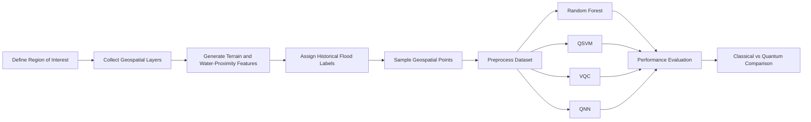

# Quantum Machine Learning for Flood Susceptibility Mapping

A comparative study of **classical Machine Learning (ML)** and **Quantum Machine Learning (QML)** approaches for flood susceptibility prediction using satellite-derived geospatial features from **Majuli Island, Assam, India**, in the Brahmaputra River basin.

**Project Date:** November 2025  
**Development Time:** Approximately 40 hours

The project evaluates a classical **Random Forest (RF)** baseline against three quantum machine learning approaches:

- **Quantum Support Vector Machine (QSVM)**
- **Variational Quantum Classifier (VQC)**
- **Quantum Neural Network (QNN)**

The goal is not only to compare predictive performance, but also to study the current strengths and limitations of QML when applied to real-world geospatial flood data.

---

## Motivation

The Brahmaputra Basin in Assam experiences frequent and severe flooding, affecting communities, agriculture, and infrastructure.

Accurate flood susceptibility mapping can support:

- Disaster-risk mitigation
- Evacuation planning
- Land-use planning
- Infrastructure planning
- Flood preparedness

Machine learning is useful for modelling nonlinear relationships between terrain, water proximity, land cover, and historical flood occurrence.

This project investigates whether **Quantum Machine Learning** can provide useful alternatives or future advantages for this type of geospatial classification problem.

---

## Study Area

**Majuli Island, Assam, India — Brahmaputra River**

Majuli is highly exposed to recurrent flooding and was selected as the study region for evaluating flood susceptibility using geospatial features.

---

## Objectives

The project aims to:

1. Build a flood susceptibility dataset using satellite and geospatial data.
2. Train a classical **Random Forest** model as a baseline.
3. Implement and evaluate **QSVM, VQC, and QNN** models.
4. Compare classical and quantum approaches on the same flood-classification problem.
5. Investigate practical limitations of current QML methods on real geospatial data.

---

## Dataset Creation

The dataset was created using **Google Earth Engine**.

### Dataset Details

- **Number of sampled points:** 2,981
- **Spatial resolution:** 100 m
- **Target:** Flooded / Not Flooded

### Features

| Feature | Description |
|---|---|
| Elevation | Derived from SRTM Digital Elevation Model |
| Slope | Terrain slope derived from elevation |
| Aspect | Terrain orientation |
| Distance to Water | Proximity of each sampled point to water |
| LULC | Land Use / Land Cover from Copernicus |
| Flood Label | Flooded / Not Flooded using historical flood information |

Historical flood labels were derived from the **Global Flood Database (2000–2018)**.

### Example Dataset Format

```text
aspect | dist_to_water | elev | flooded | lulc | slope
------------------------------------------------------
312    | 33.136083     | 99   | 0       | 40   | 3
156    | 7.071068      | 97   | 1       | 60   | 5
270    | 67.364679     | 89   | 0       | 40   | 1
```

---

## Methodology

The overall workflow is:



### 1. Geospatial Feature Extraction

Google Earth Engine was used to derive flood-related geospatial information for the selected region.

The sampled features include:

- Elevation
- Slope
- Aspect
- Distance to water
- Land Use / Land Cover
- Historical flood occurrence

### 2. Classical Baseline

A **Random Forest classifier** was used as the classical machine learning baseline.

Random Forest is suitable for this task because it can model nonlinear relationships in tabular data and handle interactions among heterogeneous geospatial features.

### 3. Quantum Models

Three Quantum Machine Learning approaches were evaluated.

#### Quantum Support Vector Machine

The **QSVM** maps classical input features into a quantum feature space and applies a quantum-kernel-based classification approach.

#### Variational Quantum Classifier

The **VQC** uses a parameterized quantum circuit whose trainable parameters are optimized for the classification task.

#### Quantum Neural Network

The **QNN** uses parameterized quantum circuits to learn a nonlinear decision function through hybrid classical-quantum optimization.

---

## Models Compared

| Model | Type | Reported Accuracy |
|---|---|---:|
| Random Forest | Classical ML | **0.74** |
| QSVM | Quantum ML | **0.56** |
| VQC | Quantum ML | **< 0.30** |
| QNN | Quantum ML | **< 0.30** |

---

## Results

### Random Forest

Random Forest achieved the strongest performance in the study.

**Reported Accuracy: 0.74**

Its performance suggests that the available flood-prediction features are well suited to classical nonlinear tabular learning.

### QSVM

QSVM achieved moderate performance.

**Reported Accuracy: 0.56**

The model performed above chance level, indicating that the quantum feature representation was able to capture some useful structure in the dataset, although it did not outperform the classical baseline.

### VQC and QNN

The VQC and QNN models performed poorly in the reported experiments.

**Reported Accuracy: below 0.30**

The project attributes this to optimization difficulties associated with variational quantum models, including problems such as **barren plateaus**.

---

## Key Observation

> **Classical Machine Learning outperformed the tested Quantum Machine Learning approaches for the current dataset and implementation.**

This does not imply that QML is unsuitable for geospatial learning in general.

Instead, the experiment highlights the current challenges involved in applying small-scale quantum and hybrid quantum-classical models to real-world datasets.

The project therefore serves both as:

- A flood susceptibility modelling experiment
- An evaluation of the practical maturity of QML for real geospatial classification

---

## Why Did Random Forest Perform Better?

Several characteristics of the problem favour the classical baseline:

- The input consists of structured tabular geospatial data.
- Random Forest naturally captures nonlinear feature interactions.
- Classical optimization methods are mature and stable.
- Current variational quantum models can be difficult to train.
- Quantum models are sensitive to feature encoding and circuit design.
- Increasing quantum circuit complexity can make optimization more difficult.
- Variational quantum circuits may suffer from barren plateaus.

The results therefore reflect the current implementation and experimental setting rather than a universal conclusion about classical vs quantum machine learning.

---

## Tools and Technologies

- **Google Earth Engine**
- **Google Colab**
- **Python**
- **Scikit-learn**
- **Qiskit**
- **Qiskit Machine Learning**
- **Matplotlib**

### Geospatial Data Sources

- SRTM Digital Elevation Model
- Copernicus Global Land Cover
- Global Surface Water data
- Global Flood Database (2000–2018)

---

## Suggested Repository Structure

```text
quantum-flood-susceptibility/
│
├── README.md
│
├── data/
│   ├── raw/
│   └── processed/
│
├── notebooks/
│   ├── data_creation.ipynb
│   ├── classical_ml.ipynb
│   └── quantum_ml.ipynb
│
├── src/
│   ├── preprocessing.py
│   ├── random_forest.py
│   ├── qsvm.py
│   ├── vqc.py
│   └── qnn.py
│
├── results/
│   ├── accuracy_comparison.png
│   ├── roc_curve.png
│   └── dataset_preview.png
│
├── assets/
│   ├── study_area.png
│   ├── feature_maps.png
│   └── project_poster.png
│
└── requirements.txt
```

> Adjust the folder and file names based on the actual structure of the repository.

---

## Running the Project

### 1. Clone the Repository

```bash
git clone <your-repository-url>
cd quantum-flood
